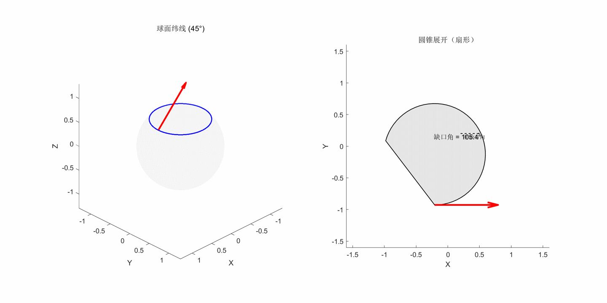

# 球面上矢量的平行传输与和乐性（Holonomy）

MATLAB 可视化：一个切矢量在球面 45° 纬线上平行传输一周时方向发生偏转——
这就是和乐性（holonomy）。脚本采用**左右分屏同步对比**：

- **左栏（球面）**：矢量沿 45° 纬线平行传输一周，箭头端点留下红色虚线轨迹，
  直观展示传输一周后矢量不再回到初始方向；
- **右栏（圆锥展开扇形）**：将纬线所在的圆锥面沿一条母线剪开展平。
  在展开面上平行传输退化为"方向不变的平移"，因此矢量始终指向同一方向；
  扇形的缺口角正好等于左栏的和乐角。



## 理论推导概要

详细推导见笔者的知乎笔记：[《更多的坐标系以及相关的张量代数计算》](https://zhuanlan.zhihu.com/p/2043322463904387633)（PHY441 广义相对论习题，2023 秋）。要点如下。

### 1. 平行传输的条件：协变微商为零

平直空间中"偏导为零"即平行传输，但在弯曲空间（或曲线坐标）中基向量随位置变化，
普通偏导不再适用。把基向量的变化用克氏符（Christoffel symbol）展开
∂ᵢ**e**ⱼ = Γᵏⱼᵢ**e**ₖ，可得到弯曲空间中平行传输的条件——协变微商为零：

> Dᵢ Aʲ = ∂ᵢ Aʲ + Γʲₖᵢ Aᵏ = 0

若空间的和乐性非平凡，全局上满足该条件的向量场不存在，
因此该条件只能在**一条给定路径上**逐点使用。

### 2. 固定纬线上的耦合微分方程

在 r = R 的球面上，非零克氏符为
Γᶿ_φφ = −sinθcosθ，Γ^φ_θφ = cotθ。
令矢量沿纬线 θ = θ₀ 传输（只有 φ 变化），代入上式得耦合方程：

```
∂A^φ/∂φ + cotθ · A^θ = 0
∂A^θ/∂φ − sinθcosθ · A^φ = 0
```

消元后得到两个谐振子型方程（k ≡ cosθ₀）：

```
d²A^θ/dφ² + k² A^θ = 0 ,   d²A^φ/dφ² + k² A^φ = 0
```

其通解正是脚本第 12–15 行解析解的来源：

```
A^θ = A^θ₀ cos(kφ) + sinθ₀ · A^φ₀ sin(kφ)
A^φ = −(1/sinθ₀) A^θ₀ sin(kφ) + A^φ₀ cos(kφ)
```

### 3. 和乐角

对 θ₀ = 45° 的纬线走一整圈（φ: 0 → 2π），初始指向正北方的单位矢量
（A^θ₀ = 1, A^φ₀ = 0）变为

```
A^θ_final = cos(√2 π) ,   A^φ_final = −√2 sin(√2 π)
```

用度规求两个矢量夹角（g_θθ = R², g_φφ = R²sin²θ）：

```
cos α = cos(√2 π)  ⟹  α = 2π(1 − sin θ₀) = 2π(1 − 1/√2) ≈ 105.3°
```

即矢量相对初始方向转过了 **105.3°**，等于纬线所围球冠的立体角（高斯–博内定理）。

### 4. 圆锥展开的等价证明

纬线周长为 2πR sinθ₀，以其为底圆的外接圆锥母线长恰为 R，
展开成平面扇形后扇形的圆心角为 2π sinθ₀，**缺口角**为

```
2π(1 − sinθ₀) ≈ 105.3°
```

与和乐角完全一致——这正是右栏扇形动画的几何含义。

## 文件说明

| 文件 | 说明 |
|---|---|
| `paralleltransport.m` | 主脚本：双栏动画 + GIF 导出 |
| `parallel_transport_compare.gif` | 预生成的对比动画（知乎上传的是降画质版） |

## 使用方法

在 MATLAB 中运行：

```matlab
paralleltransport
```

脚本会弹出动画窗口，在当前目录生成 `parallel_transport_compare.gif`，
并在命令行输出和乐角与缺口角的数值验证：

```
球面和乐角: 105.26°
扇形缺口角: 105.26°
```

## 课程背景

谢菲尔德大学 PHY441《广义相对论引论》（Ed Daw, 2023 秋）。
代码由 DeepSeek 协助编写，用于验证习题 1.3(e)(f) 的解析结果。
